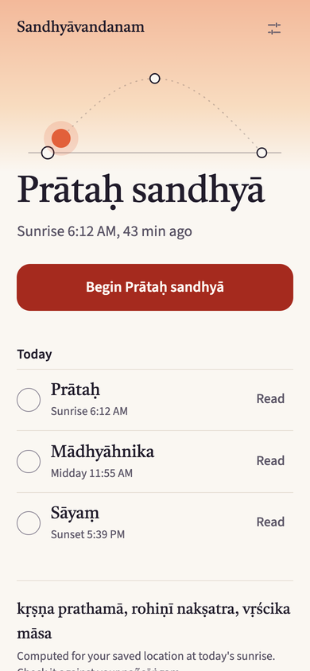
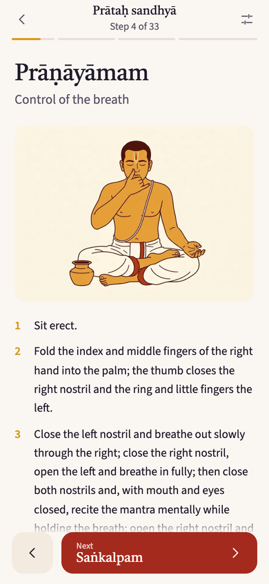
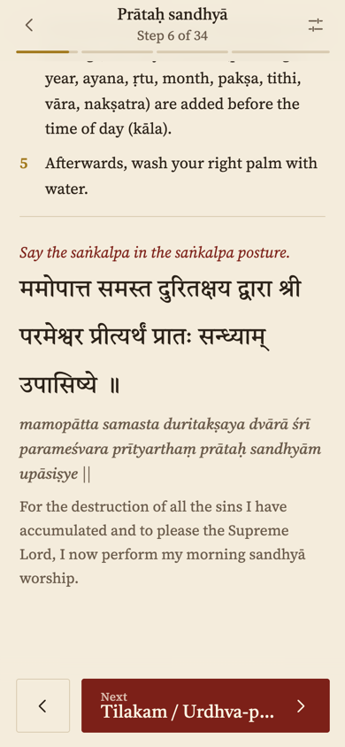
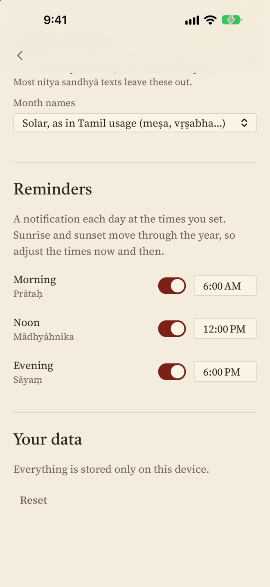

# Sandhyāvandanam

A step-by-step guide to the daily sandhyā: what to do, what to say and what it means, one step per screen. It follows Kṛṣṇa Yajur Veda (Āpastamba) in the Smārta and Śrī Vaiṣṇava traditions, for the morning, noon and evening sandhyā.

- **Website** (installable, works offline): https://sandhya.pragnyalabs.com
- **iPhone and Android apps**: the same code wrapped with Capacitor ([docs/store](docs/store/README.md)). The iPhone app is in App Store review; the Android app is built and waiting for Google Play's closed test.

Free, no account, no advertising. Nothing you enter leaves your device ([privacy](https://sandhya.pragnyalabs.com/privacy)).

| Home | A step, with its picture | Mantra, meaning, chant | Reminders (app) |
|---|---|---|---|
|  |  |  |  |

## Features

**The ritual**
- All three sandhyās (prātaḥ, mādhyāhnika, sāyaṃ) in two traditions; the steps, mantras, saṅkalpa and the direction to face change with your choice.
- One step per screen with numbered instructions and a line on the purpose of the step. Move with the buttons, a swipe or the arrow keys; the screen stays on.
- Pictures of the postures and hand positions for 15 kinds of step, drawn separately for each tradition (vibhūti or nāmam, the vessels in place).
- A step index for each sandhyā, to jump to any step.
- Parts that only some families do are hidden until you switch on "Optional parts".

**The text**
- Every mantra in the script you read: Devanāgarī, Tamil, Kannada, Telugu, Malayalam or Roman (IAST), with Vedic accent marks.
- Roman transliteration and English meaning under each line; each can be switched off.
- Your name, gotra, pravara and sūtra filled into the abhivādanam (20 gotras with their pravaras built in; you can type any other).
- Optional detailed saṅkalpam with the year, ayana, ṛtu, month, pakṣa, tithi, weekday and nakṣatra, worked out on the device for your place (solar or lunar month names).

**Chanting**
- A chant button on 220 of the 222 mantra lines. The voice is synthesised: clear syllables, but Vedic mantras in a flat tone without svaras.
- In lines with your own name or gotra the chant pauses for you to say them.
- Every step links to the same step in a recorded chant by a person.
- A Gāyatrī japa counter: the full count (108 morning, 32 noon, 64 evening), or 28 or 10.

**Day and place**
- The home screen shows the sun's path for your place, suggests the sandhyā for the time of day and marks the ones you have done.
- Today's tithi, nakṣatra and month.
- In the mobile app: a daily reminder for each sandhyā at a time you set (local notifications, no server).

**Settings**
- Tradition, script, text size, light or dark theme, what to show under each line, japa count, place, month names, reminders.
- Everything is stored on the device. The website can export and import settings as a file.

## Status

The text has been checked against the printed sources listed below (`docs/reference/source-check-2026-11-25.md`) and is still awaiting review by a knowledgeable person (`docs/REVIEW_NOTES.md`). Known gaps in the chant audio are in `docs/reference/AUDIO_GAPS.md`. See [docs/REQUIREMENTS.md](docs/REQUIREMENTS.md) for scope and decisions.

## Layout
- `app/` — the app (Vite + React + TS + Tailwind). `pnpm dev | build | test | xlit`; `pnpm ios` and `pnpm android` build the phone apps into `app/ios/` and `app/android/`.
- `docs/store/` — App Store listing text, privacy answers, icon source and build steps.
- `docs/CONTENT_GUIDE.md` — how mantras/steps are authored; `docs/REVIEW_NOTES.md` — open items for a knowledgeable reviewer.
- `docs/REQUIREMENTS.md` — product/tech decisions.
- `docs/reference/pdfs/` — source procedure texts (Kṛṣṇa Yajur Smārta & Śrī Vaiṣṇava; Śukla Yajur).
- `docs/reference/extracted/` — `pdftotext` dumps of the above.
- `docs/reference/transcripts/` — YouTube auto-captions + fetch script.

## Sources
- Pandit Sri Rama, *Kṛṣṇa & Śukla Yajur Veda Sandhyā Vandana* (srimatham.com, 2015)
- Sunder Kidambi, *Yajurveda Kālatraya Sandhyāvandanam* (prapatti.com, 2007)
- Sushil Narayanan et al., *Yajurveda Kaalai Sandhyaavandanam* (2020)
- Kaustubha Chakravarthy, *Yajurveda Sandhyavandanam – detailed procedure with illustrations* (2010)
- Anonymous, *Sandhyavandanam (Smārta, Āpastamba)*
- Videos: Soulful Mantra — *See, Learn And Perform Sandhyavandanam (Yajur–Smartha)*; Sringeri Gurubandhava — *Meaning of Sandhyavandanam Mantras* (Lalith Gannavaram)
- **Chant voice**: [Vāgdhenu](https://prathosh.in/vagdhenu/), the metre-aware Sanskrit chant synthesiser from the [Vāgbodhinī](https://prathosh.in/vagbodhini/) project by Prof. Prathosh A P (Indian Institute of Science, Bengaluru), with its Su-śrotā speech recogniser used to check every clip. Code and weights are Apache-2.0. The voice is the author's own; it is used here only to speak the mantra text, and the Vedic mantras are rendered in a flat tone because the model is not made for svara recitation.

## Deployment
Static build served by nginx on the pragnyalabs Hetzner server (`/var/www/sandhya`, HTTPS via Let's Encrypt; wildcard DNS for `*.pragnyalabs.com`).

```bash
cd app && pnpm run deploy   # test, build, rsync dist/ to the server (needs the `hetzner-agent` SSH host)
```

The site was created once with `ssh hetzner-agent 'sudo new-site sandhya /var/www/sandhya'`; redeploys only replace the files.

## Analytics
Anonymous usage counts go to a self-hosted [Umami](https://umami.is) (dashboard at `analytics.pragnyalabs.com`; the tracker itself is served first-party from this site at `/u/p.js`, which nginx proxies to Umami) (no cookies; nothing the user types is sent). The tracker loads only on the production host (`ANALYTICS` in `app/src/config.ts`; an empty `websiteId` switches it off). Besides page views the app records four events: `begin` (kāla, tradition, script), `phase` (how far people get), `complete`, and `chant` (a chant clip played). See `app/src/lib/track.ts`.
